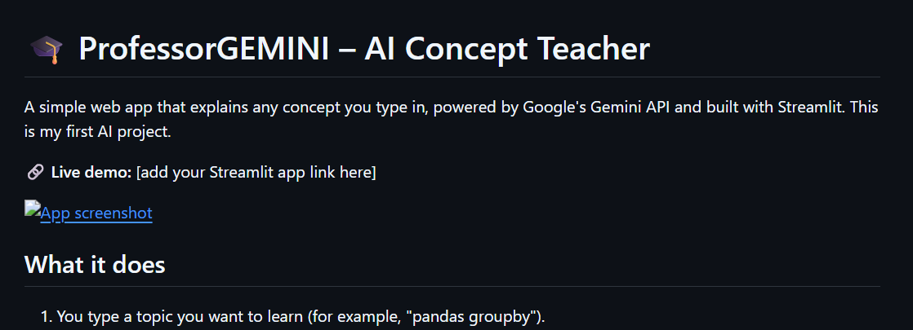

# 🎓 ProfessorGEMINI – AI Concept Teacher

A simple web app that explains any concept you type in, powered by Google's Gemini API and built with Streamlit. This is my first AI project.

🔗 **Live demo:** https://profeappr-gemini-ai-tutor-wxnz8jhsby7ijpddqptbrk.streamlit.app/



## What it does

1. You type a topic you want to learn (for example, "pandas groupby").
2. You click **Teach me**.
3. Gemini writes a short lecture on that topic and shows it on the page.

## Tech stack

- **Python**
- **Streamlit** for the web interface
- **Google Gemini API** (`google-genai` SDK, model `gemini-3.5-flash`)

## Run it on your computer

1. Clone the repo:
   ```bash
   git clone https://github.com/sirrida000/YOUR-REPO-NAME.git
   cd YOUR-REPO-NAME
   ```
2. Install the requirements:
   ```bash
   pip install -r requirements.txt
   ```
3. Get a free API key from [Google AI Studio](https://aistudio.google.com/app/apikey).
4. Save the key in `.streamlit/secrets.toml`:
   ```toml
   GEMINI_API_KEY = "your-key-here"
   ```
5. Start the app:
   ```bash
   streamlit run streamlit_app.py
   ```

## Deploy on Streamlit Community Cloud

1. Push this repo to GitHub.
2. Go to [share.streamlit.io](https://share.streamlit.io) and click **New app**.
3. Select this repo, the `main` branch, and `streamlit_app.py`.
4. In **Advanced settings → Secrets**, add `GEMINI_API_KEY = "your-key-here"`.
5. Click **Deploy**.

## Notes

- Never upload your API key to GitHub. The `.gitignore` file keeps `secrets.toml` private.
- The app uses the free Gemini tier, so it has daily limits and may pause if they are reached.
- Please don't enter personal information, since free-tier prompts may be used by Google to improve its products.

## What I learned

- Calling an AI model from Python with an API key
- Building a simple UI with Streamlit
- Keeping secrets out of code
- Deploying an app with GitHub and Streamlit Community Cloud

## Author

**Reeda Shaikh**
BTech AI & Data Science student
[GitHub](https://github.com/sirrida000) · [LinkedIn](https://linkedin.com/in/reeda-s-11914a42b)
